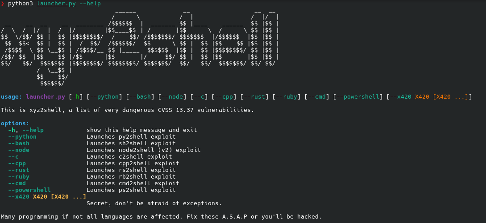

# xyz2shell - because every CVE needs a lazy name

**Updated:** 2026-11-22 
**Published:** 2026-11-23 
**Title:** Arbitrary code execution in several commonly used languages 
**CVE**: CVE-2026-421337 
**CVSS**: 13.37

### Description

Welcome to **X2SHELL**, the groundbreaking polyglot suite of satirical (and terrible) "shells" in **Python**, **Node.js**, **C**, **C++**, **Rust**, **Ruby**, **CMD**, and **PowerShell**.

Whenever a new vulnerability drops with a name like `something2rce` or `runtime2shell`, the pitch is always dramatic—until you read the prerequisites and realize you already have arbitrary code execution in that exact runtime. So here we are: eight lovingly over-engineered wrappers around running commands in the language you're already executing.

### CWE
[Learn more](https://www.cve.org/CVERecord/UserGuide/#cve-cwe)
- [CWE-78](https://cwe.mitre.org/data/definitions/78.html) - Improper Neutralization of Special Elements used in an OS Command
- [CWE-95](https://cwe.mitre.org/data/definitions/95.html) - Improper Neutralization of Directives in Dynamically Evaluated Code
- [CWE-1188](https://cwe.mitre.org/data/definitions/1188.html) - Initialization of a Resource with an Insecure Default

### CVSS
[Learn more](https://www.cve.org/CVERecord/UserGuide/#cve-cvss)
| Score | Severity | Version | Vector String |
| ----- | -------- | ------- | ------------- |
| 13.37 | SATIRICAL | 3.1 | CVSS | CVSS:3.1/SH:E/LL:T/OS:H/EL:L/I:S/N:O/T:A/C:V/E:L/OO:L/SI:S |

### Included Vulnerabilities
- c2shell aka IRON POINTER
- cmd2shell aka SHELL COMMANDER
- cpp2shell aka COPPY CAT
- node2shell v2 aka V8 MIRAGE
- ps2shell aka PIPELINE PUNK
- py2shell aka CIPER DROP
- rb2shell aka RUBBY DUCKY
- rs2shell aka CRAB ECLIPSE
- sh2shell aka SHELL BASHER

### Philosophy
**Lazy Naming:** Take a runtime, slap `2shell` onto it, call it a day. 
**Cross-Platform Apathy:** Windows uses `\`? Cool story. We're splitting on `/` anyway. Nobody opens Windows when it's cold outside!

### LICENSE
乁(ツ)ㄏ